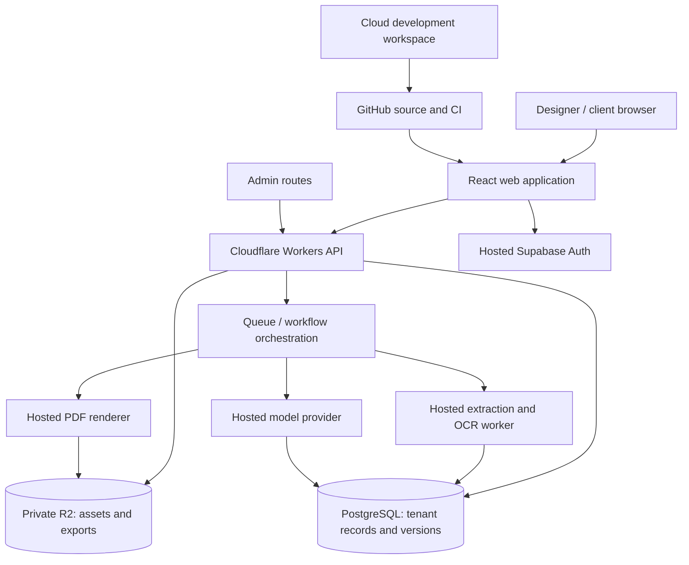

# Architecture

Status: proposed implementation contract, not deployed infrastructure.

## System boundaries



One modular application plus job processors. Do not begin with microservices, Kubernetes, a vector database or model training. The browser renders the interactive UI; server processes run in cloud services. No owner-computer server, CLI installation or local inference is part of the operational design.

## Modules

| Module | Owns | Must not own |
|---|---|---|
| Identity/workspaces | Membership, invitations, server authorization | Client-authoritative roles |
| Brands/assets | Approved facts, upload lifecycle, file metadata | Guideline-specific overrides |
| Documents | Versioned blocks, drafts, revisions, optimistic concurrency | Executable imported templates |
| Templates | Layout definitions, bindings, immutable versions | Automatic overwrites of existing documents |
| Publishing | Snapshot selection, share grants, revocation | A live pointer to an unfinished draft |
| Jobs | Status, retries, idempotency, bounded work | Unlimited background spend |
| AI | Scoped suggestions, model routing, validation | Silent commits or permission inference |
| Moderation | Submission copies, decisions, reports | Unrestricted private-project browsing |

## Core representation

Separate **Brand facts → Document content → Template design → Document overrides**. Use JSON Schema/Zod to validate a versioned document structure; relational ownership/version/job metadata remains in PostgreSQL. Every import maps into the same schema used by manually created documents. Each template refers to supported components, never uploaded executable HTML/JS.

- Text, logo, image, palette, type specimen and usage-example blocks.
- Stable IDs and ordering; bounded fields and content sizes.
- Bindings such as `brand.primaryLogo`, `brand.colors.primary`, `brand.name`.
- Template version pinning; schema migrations create new revisions.
- Export and share records reference immutable revision IDs.

## Authorization and storage

Validate the authenticated identity and membership on every API operation. PostgreSQL row-level policies are defense in depth. Browser roles and hidden buttons are not authorization. Service-role credentials never enter client bundles. R2 has its own authorization path: database policies do not protect it automatically.

Uploads use short-lived object-specific grants after quota/type checks. Store bytes under opaque tenant-scoped keys, then verify final size and actual type. SVG and font processing require isolated sanitization/validation. PDFs are untrusted input and their extracted text is not agent instruction.

## Jobs and consistency

A request creates a job and returns `202` with an ID. A database transaction/outbox prevents lost enqueue events. Consumers tolerate at-least-once delivery; deduplicate by operation and idempotency key. Record stage and retry counts, use bounded backoff, and provide a dead-letter path. A retry cannot create a second published version or double-charge usage. Provider callbacks require signature checks and replay protection.

Edits include a base revision or ETag. Reject stale writes with `409` and preserve both versions for recovery. Publication, permission grants and exports are explicit operations, not autosave side effects. Transactional database operations never assume distributed transactions with R2; reconciliation jobs clean incomplete uploads and orphan outputs.

## Rendering and AI

A controlled renderer shares document components and layout constraints with the preview. Hosted Chromium/PDF service must be proved with fonts, vectors, long text, page breaks and supported print settings in P0/P5. Workers do not magically run arbitrary Node/Python or long-running Chromium. Cloudflare Browser Rendering/Queues availability and quotas are a P0 check; unsuitable heavy imports use an isolated hosted processing service.

AI takes a minimum necessary context and returns schema-validated suggestions. Store proposals against their input revision; acceptance checks that revision again. Manual editing survives provider downtime. Reference retrieval and training are distinct permissioned later features.

## Planned repository shape after scaffolding

```text
apps/web/          React routes and application compositions
apps/api/          Workers endpoints and authorization middleware
packages/ui/       Canonical accessible primitives
packages/domain/   Document, asset, template and lifecycle schemas
packages/render/   Shared guideline renderer and print layout
packages/tokens/   Generated adapters from design-system/tokens.json
workers/           Import/export/AI job handlers
supabase/          Versioned schema migrations and policy tests
```

These directories are planned; do not import them until implemented. See [data model](docs/architecture/data-model.md), [API contracts](docs/architecture/api.md), [security/admin](docs/architecture/security-admin.md), and [cloud operations](docs/architecture/cloud.md).
