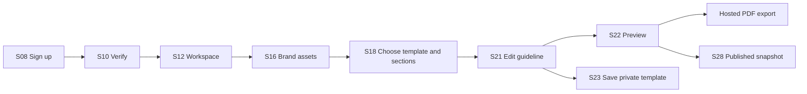

# User journeys and recovery

## Create a guideline

A visitor’s template selection survives authentication. Brand creation proceeds to brand overview with a clear Create guideline action. Guideline creation is an intentional **create-and-edit** variant and opens the editor. Routine metadata edits return to their owning detail view. Autosave never publishes.

## Import an existing PDF/image

S19 → select source/page scope → choose “Use existing content” or “Use as layout reference” → review allowance → queued job → S20 side-by-side review → correct uncertainties → assign reusable fields → S21 → optional private template. Source file stays private. Failed pages do not discard successful work. Unsupported elements are labeled image blocks, not falsely called editable.

## Publish and revoke

Editor → delivery → inspect exact revision and downloadable assets → publish confirmation → published link. Later draft edits do not affect it. Republish creates/selects a new immutable snapshot. Revoke invalidates future access and applicable caches; downloaded copies remain outside platform control.

## Template contribution

Private template → separate sanitized copy → replace customer content → preview exact contribution → rights declaration → optional separately scoped AI permissions only if implemented → submit → moderator checks → approve / request changes / reject → contributor notification. Template approval is not legal verification of all ownership claims.

## Administration

Admin sign-in/role check → own permitted queue → detail/evidence → scoped action with reason → result/audit event. Support sees operational metadata. Moderator sees the submitted copy. Operations retries eligible jobs without opening private content unnecessarily.

## Failure/recovery map

| Trigger | Pending | Success | Failure recovery |
|---|---|---|---|
| Create brand | Prevent duplicate submit | Brand overview + status | Preserve fields; inline errors |
| Save editor | Saving state without layout movement | Saved time/revision | Preserve edits; retry or resolve conflict |
| Generate AI proposal | Cancellable progress where supported | Review proposal | Manual editing stays available |
| Export revision | Job progress | Download prepared artifact | Retry same operation safely |
| Publish snapshot | Confirm scope then processing | Link and revision shown | No false Published state |
| Submit template | Validation and queue | Submission detail | Preserve sanitized draft |
| Admin restriction | Reason + scoped confirmation | Audit and account state | Keep prior state; explain error |

## Accessibility/keyboard

All actions have semantic controls. Modals trap and restore focus; tabs follow established keyboard patterns. Reorder has buttons/keyboard alternatives. Upload offers file picker alongside drop target. Color values have text fields and validation, not only visual pickers. Session expiry preserves recoverable in-memory work and resumes the intended route after reauthentication.
